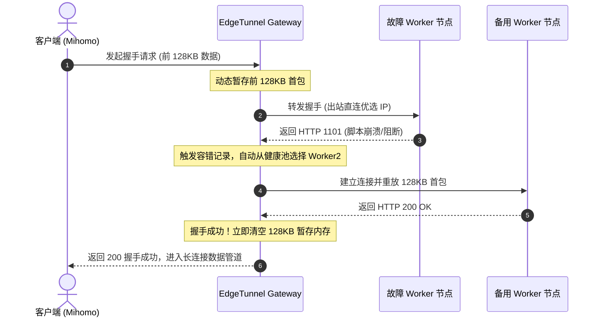

# 📐 核心架构与原理解析 (Architecture & Mechanisms)

**EdgeTunnel Gateway** 并非普通的简单反向代理，而是针对 Cloudflare 边缘生态网络特性、客户端请求差异及多账户免费额度分布进行了深度自适应重构的专用智能网关。

---

## 🏛️ 1. 底层引擎思辨：为什么选择 Node.js 20 ESM？

在网络反代领域，通常有 Nginx / OpenResty、Envoy、Pingora (Rust)、Go 及 Node.js 等技术选型：

| 维度 | Nginx / OpenResty | Go 二进制单文件 | Node.js 20 ESM (本项目选型) |
| :--- | :--- | :--- | :--- |
| **运行时体积** | 中等，C 模块扩展门槛高 | 极小，单静态文件 | **极小**（Alpine 镜像仅约 40MB） |
| **动态业务编排** | 依赖 Lua 胶水代码，调试复杂 | 强类型，重构需重新编译 | **原生异步事件循环 (libuv)**，单线程天然适合 I/O 密集型流转发 |
| **高级协议支持** | H2C / H2 双模嗅探支持较弱 | 原生支持需编写复杂 mux | 原生支持 HTTP/2、原生 Fetch、GraphQL、SSE |
| **热更新便利度** | 需 reload 配置 | 需重新 build 并替换二进制 | **文件挂载即生效**，控制台 500ms 平滑热重启 |
| **实际 CPU 负载** | 百兆流量 < 1% | 百兆流量 < 1% | **百兆/千兆日常使用 CPU 占用低于 2%** |

> **架构结论**：在家庭宽带与中小企业千兆并发场景下，Node.js 20 ESM 兼具极低的开发维护心智成本、极致的灵活性与强悍的异步转发性能。

---

## 🔌 2. 独立端口分流体系

网关严格在物理端口层将不同协议与业务面隔离，避免跨协议协商损耗：

```text
       ┌───────────► 端口 8787: Pages 专属 (原生 WebSocket Upgrade 全双工)
入站请求 ┼───────────► 端口 8788: Worker 专属 (首包嗅探双模自适应: H2C / H1.1)
       └───────────► 端口 8789: Web UI 管理控制台 & REST API (管理面)
```

---

## ⚡ 3. 首包嗅探双模自适应原理解密 (端口 8788)

### 痛点背景
- **Mihomo (Clash Meta)** 在 `tls: false` 时，会发送符合 RFC 7540 标准的明文 H2C 握手魔数（`PRI * HTTP/2.0\r\n\r\nSM\r\n\r\n`）；
- **v2rayN (Xray-core)** 在 `security: none` 时，会将 XHTTP 退化为标准的明文 `HTTP/1.1 POST` 流式分块传输；
- 若仅支持单一模式，用户在不同客户端之间切换时必须频繁更改端口。

### 嗅探分发流程
网关在 `8788` 端口前置了一层极轻量的纯净 TCP 环回代理（`net.createServer`）：
1. 客户端建立 TCP 连接后，网关使用 `socket.once('data', chunk => ...)` 拦截第一个数据包的前 24 个字节；
2. **魔数匹配**：
   - 若前 24 字节为 `PRI * HTTP/2.0\r\n\r\nSM\r\n\r\n`，判定为 **Mihomo H2C**，瞬间转发至内部隔离的 H2C 引擎；
   - 否则判定为 **v2rayN H1.1 POST**，转发至内部隔离的 HTTP/1.1 引擎；
3. 将首包写入目标端口并执行全双工零损耗 `pipe` 管道透传，对后续流传输带来 **0 性能损耗与 0 延迟**！

---

## 🔄 4. 首包 128KB 暂存与透明故障转移 (Failover Retry)

在直连 Cloudflare 边缘节点时，常常由于边缘机房过载或 Worker 实例瞬时冷启动崩溃返回 **`1101`（Worker 脚本崩溃）**、`502`、`429`（并发超限）或 `521` 错误：



- **客户端完全无感**：整个透明重试过程发生在网关内部（默认最多重试 2 次），客户端无需重新断开建连；
- **内存安全**：一旦握手成功（200 OK），网关立即执行 `initialChunks.length = 0`，绝不随长连接留存冗余 Buffer！

---

## 🚀 5. HTTP/2 弹性多连接池 (Elastic Multi-Session Pool)

在 XHTTP 协议中，多个客户端请求会复用 HTTP/2 连接中的 Stream。如果所有流量强行挤在单条 TCP 连接中，在大并发多线程下载或大文件分块传输时，极易因单个 TCP 数据包丢包而触发全连接级别的 **TCP 队头阻塞 (Head-of-Line Blocking)**。

网关设计了弹性会话池：
- 每个目标后端最多维护 **4 条并发 H2 会话**；
- 当某条连接的并发流数 `> 15` 时，自动弹性开辟新连接分流承载；
- 会话空闲超过 60 秒自动优雅关闭释放，既兼顾了连接复用的低握手延迟，又彻底消除了队头阻塞。

---

## ⚖️ 6. 调度认知重构：为什么废除 EWMA，回归平权雨露均沾轮询？

很多负载均衡网关喜欢使用“EWMA 指数加权移动平均延迟”来给节点加权，但针对 Cloudflare 边缘生态，这是一种**严重的伪优化与负优化**：

1. **物理网络本质辨析**：
   - 客户端请求出站直连同一个物理优选 IP；
   - 不同的 Worker 域名背后实际都运行在同一组 Cloudflare 边缘机房甚至同一台物理宿主机上；
   - 所谓“各 Worker 节点的延迟差异”，100% 来自于本地测试波动或客户端不同优选 IP 的链路抖动，Worker 节点本身到达边缘机房的物理 RTT 完全一致！
2. **EWMA 带来的负优化灾难**：
   - 若根据抖动延迟给节点打分，会导致“看似快”的单节点承担 80% 以上的流量；
   - 结果该账户每日 10 万次免费配额被迅速刷爆，而其他节点的配额大量闲置，彻底违背了“多账户平摊配额”的根本目的！
3. **果断回归平权轮询**：
   - 严格采用**平权均衡轮询 (Fair Round-Robin)**，让所有可用节点雨露均沾；
   - 配合 Cloudflare 官方 API 巡检，单账户达到 95% 额度时自动避让移出健康池，实现多账户配额消耗的极致平摊。

---

## 🌐 7. 出站 SNI / Host 伪装与 Path 纯净化流水线

当客户端请求到达网关时：
1. **提取参数**：网关从客户端 Path 中提取 `prefer=优选IP:端口`；
2. **Path 清洗**：正则剔除 `prefer=...` 及其前后的 `?`、`&` 和多余末尾斜杠，还原 Cloudflare Worker/Pages 脚本所期望的纯净合法路径；
3. **物理出站直连**：网关使用从 prefer 中清洗出的最优 IP 和端口作为实际 TCP 连接目标；
4. **TLS 握手伪装**：在 TLS 握手时将 SNI 与 HTTP Host 重写为当前被轮询到的真实 Worker / Pages 域名，完成安全的端到端加密代理。
