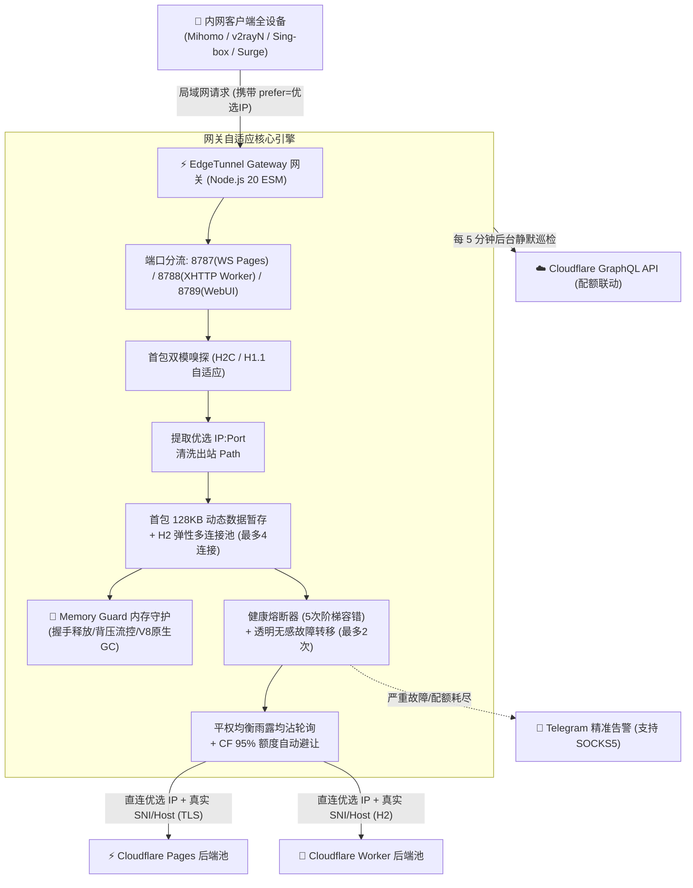

# ⚡ EdgeTunnel Gateway (edgetunnel-gateway) 官方知识库与运维维基 (Wiki)

欢迎查阅 **EdgeTunnel Gateway 本地自适应动态分流网关** 官方文档知识库！

本项目专为 **Cloudflare Pages / Workers ([EdgeTunnel](https://github.com/cmliu/edgetunnel))** 隧道生态量身打造，是一款运行于本地网络（群晖 NAS、软路由或 Linux 物理服务器）的轻量级高性能透明分流与负载均衡网关。

---

## 🌟 核心价值全景

---

## 📚 维基文档索引导航 (Wiki Sitemap)

为了方便快速查阅，文档按使用场景划分为 7 大核心专题：

| 章节编号 | 维基主题 | 适用人群与内容要点 |
| :--- | :--- | :--- |
| **[01. 快速上手指南](01-快速上手指南-Quick-Start)** | **[Quick Start](01-快速上手指南-Quick-Start)** | 适合初次部署。涵盖群晖 NAS Container Manager 图形化部署、Linux Docker Compose 部署、Macvlan 独立网络配置与初次运行向导。 |
| **[02. 核心架构与原理解析](02-核心架构与工作原理-Architecture-&-Mechanisms)** | **[Architecture & Mechanisms](02-核心架构与工作原理-Architecture-&-Mechanisms)** | 深度解析网关核心机理：首包双模嗅探 (H2C vs H1.1 POST)、128KB 暂存透明故障转移、H2 弹性多连接池、平权均摊轮询原理。 |
| **[03. 全量配置参数手册](03-全量配置参数详解-Configuration-Guide)** | **[Configuration Guide](03-全量配置参数详解-Configuration-Guide)** | 详尽列出环境变量（`docker-compose.yml`）、Web 控制台配置、CF 额度自动避让阈值、历史快照自动备份与一键回滚机制。 |
| **[04. 客户端对接与转换](04-客户端接入与-Sub-Store-指南-Client-Integration)** | **[Client Integration](04-客户端接入与-Sub-Store-指南-Client-Integration)** | 详述 Sub-Store 节点清洗与重定向脚本，提供 Mihomo (Clash Meta)、v2rayN、Sing-box、Surge、Shadowrocket 等客户端标准配置模板。 |
| **[05. Cloudflare 额度监控](05-Cloudflare-额度监控与联动-Cloudflare-Quota-Monitoring)** | **[Cloudflare Quota](05-Cloudflare-额度监控与联动-Cloudflare-Quota-Monitoring)** | 官方 API 直连模式 (Direct) 与 UsagePanel 镜像模式配置教程、GraphQL API 权限配置、多子账户绑定联动与 Telegram 告警配置。 |
| **[06. 内存治理与性能调优](06-内存治理与性能调优-Memory-Guard-&-Performance)** | **[Memory Guard & Performance](06-内存治理与性能调优-Memory-Guard-&-Performance)** | 详解网关独创的 Memory Guard 内存守护架构：首包暂存释放、全链路背压流控、Socket 互锁销毁、V8 原生 GC 开启与后台自动巡检。 |
| **[07. 常见问题与故障排查](07-常见问题与故障排查-FAQ-&-Troubleshooting)** | **[FAQ & Troubleshooting](07-常见问题与故障排查-FAQ-&-Troubleshooting)** | 避坑与疑难解答：为什么必须设置 `tls: false`、1101/502 错误排障、优选 IP 测速本质辨析、Docker Macvlan 通讯隔离解决办法。 |

---

## ⚡ 核心设计哲学 (Design Philosophy)

1. **尊崇物理本质，拒绝虚假加权**：
   - 客户端出站直连同一个物理优选 IP 时，所有 Worker 后端抵达 Cloudflare 边缘机房的 RTT 几乎完全一致。
   - 彻底废除 EWMA 延迟加权，采用纯净坚挺的**平权雨露均沾轮询 (Fair Round-Robin)**，让每一个 Cloudflare 免费账户的 10 万次配额都能得到最完美的平摊消耗。
2. **两端职责严格解耦**：
   - **优选 IP 物理网络链路层故障**（超时、断开、拒绝连接）：网关毫秒级快速断开，直接交由客户端（如 Mihomo 策略组）执行秒级无感切流，杜绝无效死等；
   - **Cloudflare 业务阻断**（1101 脚本崩溃、429 超额、502 错误）：此时物理连接通畅，网关在后台通过 128KB 首包暂存无感切换备用 Worker 重试。
3. **极简极轻，零黑盒依赖**：
   - 全栈采用 Node.js 20 ESM 原生架构，前端原生 Vanilla HTML/CSS/JS，零构建工具打包，代码 100% 透明可审计。

---

> 💡 **快速提示**：想要立刻在你的 NAS 或服务器上部署？请直接查阅 **[01. 快速上手指南](01-快速上手指南-Quick-Start)**！
